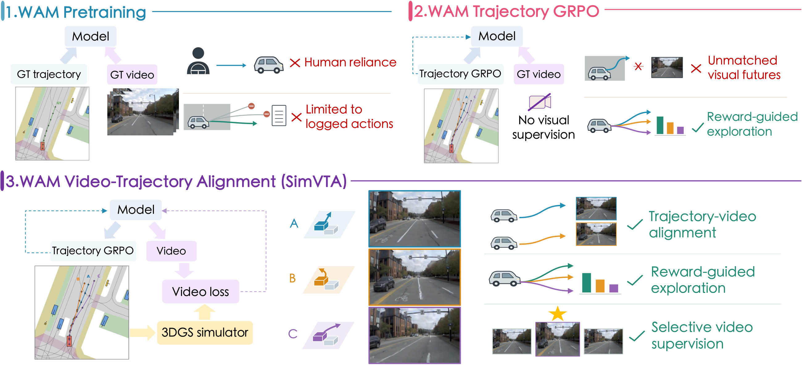
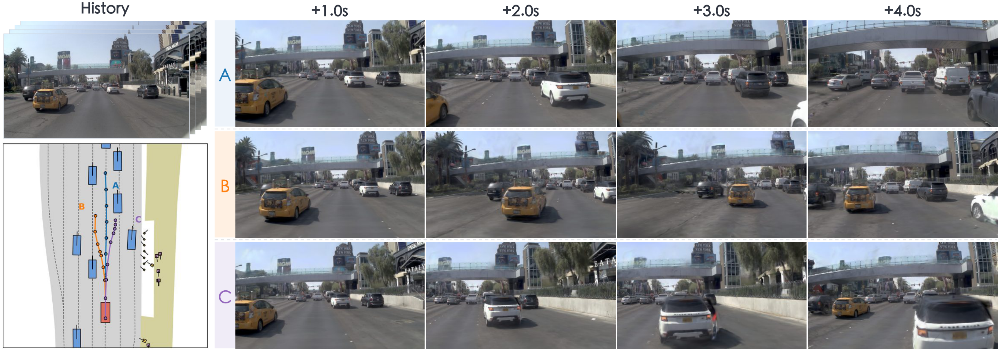
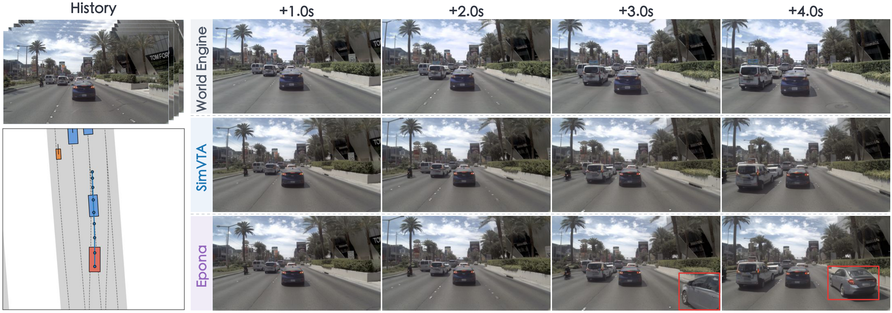

# SimVTA: Simulation-Grounded Video-Trajectory Alignment for Driving World Action Models

Changhui Jing1,2,4, Haochen Tian2, Hongchen Li1,2,4, Tianyu Li1, Caojun Wang1, 
Zihao Zhang2, Yanhao Liu1, Chengen Xie1, Bailin Li3, Hao Zhao5, Zhenjie Yang2,‡

1 Shanghai Innovation Institute · 2 OpenDriveLab at The University of Hong Kong 
3 Li Auto Inc. · 4 Tongji University · 5 Tsinghua University

> 📧 Primary Contact: Changhui Jing ([changhui.jing@opendrivelab.com](mailto:changhui.jing@opendrivelab.com))  
> ‡ Corresponding Author: Zhenjie Yang

---

  

**From logged futures to candidate-matched supervision.** WAM pretraining uses the ground-truth trajectory and its logged future video. Trajectory GRPO explores candidate trajectories using driving rewards, without matched video supervision. World Engine renders reconstructed scenes along selected candidate paths, providing matched supervision independent of the model's predictions.

## Overview

**SimVTA** is a simulation-grounded post-training framework that combines trajectory optimization with video supervision for driving world action models. Driving logs provide future videos only for recorded trajectories; SimVTA supplies matched visual supervision for alternative actions by rendering reconstructed real-world scenes along high-reward candidate paths with a 3D Gaussian Splatting simulator.

Under a limited rendering budget, SimVTA prioritizes higher-error futures among the rendered candidates. It jointly optimizes trajectory planning with Group Relative Policy Optimization (GRPO) and video prediction with a flow-matching loss that updates shared representations. At inference time, the model predicts trajectories directly, without simulator calls.

Reported results in the paper:

| Benchmark | Metric | SimVTA |
| --- | --- | --- |
| NAVSIM v1 | PDMS | **91.3** (+5.1 over the 86.2 initialization) |
| NAVSIM v2 | EPDMS | **88.2** |
| HUGSIM | Average HD-Score | **37.3** |

## Matched Futures for Alternative Actions

  

**Matched futures for alternative actions.** Left: shared observation history and executed paths for going straight (A), changing lanes to the left (B), and changing lanes to the right (C). Right: corresponding future frames rendered by the simulator. Colors match the paths and image rows.

## Video-Trajectory Alignment

  

**Video-trajectory alignment before and after post-training.** Left: observation history and trajectory in bird's-eye view. Right: World Engine renderings and predictions from SimVTA and Epona.
